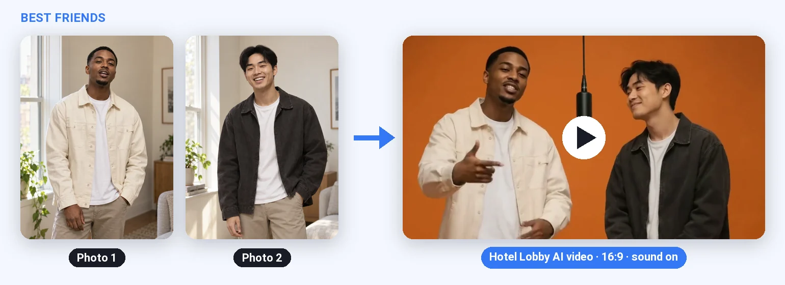
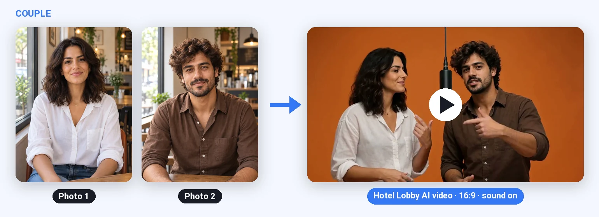
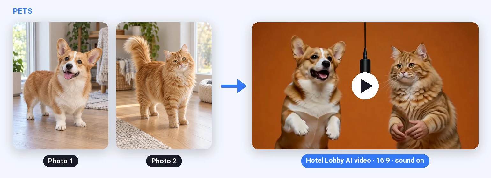
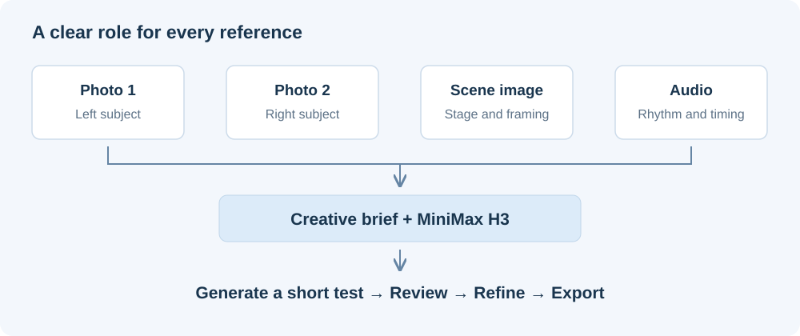

# How Do We Turn Two Photos into a Hotel Lobby AI Video?

A Hotel Lobby AI video has a recognizable setup: two performers, an orange studio, a hanging microphone, and a short rap duet. Creating that effect means making several decisions work together. The people should remain recognizable, the stage should stay consistent, and the movement should feel connected to the music.

At Picsman, we approach this as a reusable creative workflow. The user supplies two photos. A prepared scene image defines the stage, an audio reference guides the performance, and a prompt explains the role of each input. We currently use **MiniMax H3 in Reference to Video mode** for this combination.

We chose images and audio for the current template to keep costs down. A reference video is another useful option when the goal is to follow a specific performance more closely. The choice depends on how much control the result needs.

Here is how we organize the workflow behind the [Picsman Hotel Lobby AI generator](https://www.picsman.ai/tools/ai-video-generator/hotel-lobby-ai), from choosing references to reviewing the finished clip.

## Start with the result you want

Before choosing a model or writing a prompt, define what makes the video successful. For this format, the priorities are recognizable subjects, a shared orange stage, a stable microphone, and a convincing musical interaction.

The examples below are the existing clips from our Hotel Lobby tutorial. They illustrate three ways to use the format; the workflow described here reflects our current template as of October 15, 2026.

### Two friends

[Watch the friends example with sound](hotel-lobby-ai-best-friends.mp4).

The two photos establish different faces and outfits. The creative task is to bring those people into one scene while preserving the features that make each recognizable.

### A couple

[Watch the couple example with sound](hotel-lobby-ai-couple.mp4).

Here, the interaction matters as much as the individual appearance. Glances, small reactions, and alternating gestures help the pair feel like they are performing together.

### A corgi and a cat

[Watch the pets example with sound](hotel-lobby-ai-pets-cat-corgi.mp4).

Pets introduce a style choice. This example takes an anthropomorphic approach to the performance. If the intended result should retain natural animal anatomy, specify paws and animal proportions when describing the movement.

## Give each reference one clear role

The workflow separates appearance, setting, and performance timing. That makes it easier to describe what should change and what should stay consistent.

| Reference | Its job |
| --- | --- |
| Image 1 | Define the left performer's face, hair, skin tone, and clothing |
| Image 2 | Define the right performer's identity and outfit |
| Image 3 | Define the orange studio, lighting, composition, and hanging microphone |
| Audio 1 | Guide the soundtrack, rhythm, vocal entrances, and phrase timing |

The scene image contains two performers in the desired composition. Our prompt asks the model to replace them with the subjects from Images 1 and 2, while retaining the environment. The rooms in the two portrait photos should not influence the final stage.

For the identity photos, choose one clearly visible subject per image. A view close to the intended output angle gives the model a more useful reference. If clothing should remain recognizable, include enough of the outfit in the photo too.

The scene reference should already show the framing you want. A centered hanging microphone and enough space for both performers provide a concrete starting point, so the prompt can focus on the performance.

## Choose a model that fits the reference plan

The model needs to handle the references the workflow relies on. For our current design, that means separate character images, a scene image, and audio in the same generation.

We use **MiniMax H3 Reference to Video** for that combination. MiniMax's [official H3 guidance](https://agent.minimax.io/tools/ai-video-generator) describes using image, video, and audio references, with a clear instruction about what each should contribute.

Other approaches can also work:

| Approach | When it is useful |
| --- | --- |
| MiniMax H3 Reference to Video | Combine character, scene, and audio references; optionally add a performance video |
| Seedance 2.0 with multimodal references | Explore another model for combined image, video, and audio guidance, subject to the chosen service's access and input requirements |
| Image to Video | Animate a prepared image that already contains both subjects and the desired stage |
| A motion-control workflow | Follow a source performance when the movement sequence is a central requirement |

BytePlus documents [combined reference workflows for Seedance](https://docs.byteplus.com/en/docs/byteplus_las/video_gen_enhanced). It is another candidate to evaluate with the same photos, stage, and music.

Choose based on the kind of control you need, then compare the outputs under the same conditions. A model that produces an attractive scene may still miss a subject's identity or the intended rhythm. Those details matter more to this format than a general model ranking.

## Write the prompt as a creative brief

Our [full template prompt](hotel-lobby-template.txt) covers six decisions: who appears, where they appear, how the camera behaves, how they move, how they follow the audio, and which visible errors to avoid.

### Assign each person to a position

Explain that the person from Image 1 replaces the left performer in Image 3, and the person from Image 2 replaces the right performer. Specify that faces, hairstyles, skin tones, and clothing follow the corresponding identity photo.

This assignment matters throughout the clip. Both people need to stay recognizable when they turn, gesture, or look at each other.

### Preserve the stage and microphone

Use Image 3 as the environment reference. Keep its orange background, lighting, spacing, and microphone placement consistent. Describe the microphone as a stationary object, including its suspension cable.

These concrete details give the scene its recognizable appearance. They also make the result easier to review: an unexpected background change or moving microphone is immediately visible.

### Keep the camera simple

Our template uses a fixed, front-facing medium shot with both performers' hands and wrists visible. This gives the duet room to move while keeping the two identities and central microphone easy to follow.

Add camera movement only when it serves the intended result. A short performance already has faces, mouths, hands, and two people interacting; a stable viewpoint keeps the brief focused.

### Describe interaction and pauses

Ask for small gestures with preparation, emphasis, release, and rest. One performer can emphasize a phrase while the other nods, glances across, or responds with a restrained movement.

Continuous movement on every beat can look mechanical. Phrase-level pauses and complementary reactions give the model a more useful description of a duet.

### Give the audio a defined purpose

Our prompt asks Audio 1 to supply the soundtrack and performance timeline. Vocal entrances, accents, and pauses should guide the mouth movements and gestures.

Review the generated sound and performance together. An audio reference guides generation, but the result still needs a check for changed music, misplaced vocal entrances, or mouth movements that do not follow the intended passage.

### Use specific constraints

Name the errors that would spoil this scene: the two people exchanging positions, faces changing, gestures repeating, hands passing through the microphone, or unwanted text appearing.

For a pet version, revise the movement instructions to match the chosen style. Human hand and finger instructions can encourage an anthropomorphic result, which may be appropriate for comedy but inconsistent with a natural-animal brief.

## A short prompt you can adapt

This shorter version is a starting point for experiments, rather than the verbatim template prompt:

> Create a photorealistic rap duet in the orange studio shown in Image 3.
>
> Use Image 1 for the performer on the left and Image 2 for the performer on the right. Preserve each person's face, hair, skin tone, and clothing. Use Image 3 for the environment, lighting, composition, and central hanging microphone.
>
> Keep a fixed, front-facing medium shot with both performers' hands and wrists visible. Maintain their positions and spacing. The background, microphone, and suspension cable remain stationary.
>
> Use Audio 1 as the soundtrack and performance timeline. Let the performers trade emphasis naturally: one gestures while the other nods or responds. Include small gestures, clear pauses, and brief rest between phrases. Coordinate mouth movements with the relevant vocal passages.
>
> Maintain both identities throughout. Avoid mirrored movements, repetitive gesture loops, distorted hands, position swaps, subtitles, and logos.

The accompanying prompt files include a [compact version](hotel-lobby-compact.txt), a [pet adaptation](hotel-lobby-pets.txt), and a [video-reference adaptation](hotel-lobby-with-video.txt). The adaptations are intended for testing and refinement.

## Decide whether to add a reference video

Audio and video provide different kinds of performance guidance. Audio communicates rhythm and vocal timing. A video can also show the gestures, head movements, and interactions to follow.

Our current template omits a reference video to keep costs down. The model creates movement from the images, audio, and written brief. When a particular choreography matters, a video reference becomes a useful addition.

| Design choice | Images and audio | Images, audio, and video |
| --- | --- | --- |
| Appearance and stage | Supplied by the three images | Supplied by the same three images |
| Musical timing | Guided by the audio | Guided by audio aligned with the video |
| Gesture sequence | Created from the brief | Guided by the source performance |
| Best fit | A recognizable, flexible interpretation of the format | A closer interpretation of a particular performance |
| Cost decision | Our current choice to keep costs down | Consider the extra reference against the actual generation quote |

When combining video and audio, trim them to the same performance interval. Then explain what the video controls and what the images control:

> Use Video 1 for body gestures, head movements, and performance timing. Keep the left and right identities from Images 1 and 2, and the studio and microphone from Image 3. Use Audio 1 as the soundtrack. Ignore the source video's identities, wardrobe, and background.

Also decide whether to follow the video's camera movements and cuts. If you want a fixed shot, state that. If you want its camera timing, revise the fixed-camera instruction so the two directions do not conflict.

The [arelion.dev case study](https://arelion.dev/case-studies/hotel-lobby-ai-video/) demonstrates a video-reference route. Our workflow uses a scene image and audio for its current cost target, with video available as an additional source of motion guidance.

## Use a short test to refine the result

Start with five seconds at 768p. That gives you a manageable clip for checking appearance, staging, and performance before choosing a longer duration or 2K output.

Watch the beginning, middle, and end. A good first frame is only part of the result; the subjects and stage should remain consistent while the performance develops.

| What to review | What to adjust first |
| --- | --- |
| Each subject remains recognizable | Use clearer photos and confirm the left/right assignment |
| The stage and microphone stay consistent | Strengthen the scene reference and fixed-camera instructions |
| Gestures feel varied and continuous | Reduce constant arm movement and add pauses between phrases |
| The pair interact naturally | Describe alternating emphasis and small responses |
| Sound and mouth movements fit the same passage | Check the chosen audio excerpt and the performance instructions |
| A specific movement sequence is missing | Test an aligned video reference |

Change one part of the brief at a time. Keep the successful references and scene instructions stable while you adjust the weak part. This makes it easier to understand which change improved the output.

Our template offers five-, ten-, and fifteen-second clips, with 768p and 2K quality choices. Move to the desired final settings once the short test meets the creative brief. Compare cost across the attempts needed to reach an acceptable result, as well as the price of one generation.

## Turn the workflow into a simple template

The reusable parts are the scene, audio, prompt, and initial settings. The personalized parts are the two subjects. Keeping those roles separate lets the user concentrate on choosing good photos.

In Picsman, the flow is:

1. Open the Hotel Lobby template and add two photos.
2. Review the prepared references and output settings in the editor.
3. Choose a short duration and initial quality, then generate a test.
4. Review the performance, adjust if needed, and download the final clip.

The same structure can support friends, couples, or pets. The stage and music provide continuity, while the photos and performance brief define each variation.

Try the [Hotel Lobby AI template on Picsman](https://www.picsman.ai/tools/ai-video-generator/hotel-lobby-ai), or use the reference roles and prompt examples above to design your own workflow.

For inline video playback, download this repository and open the [HTML version](preview.html) locally.
